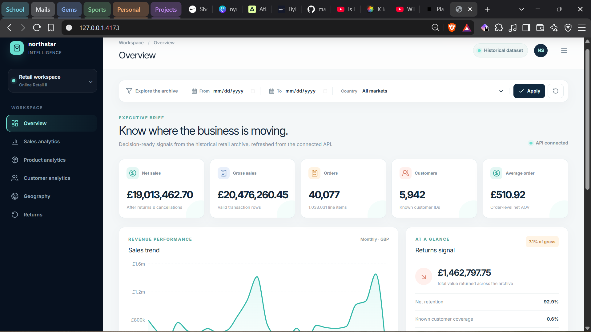
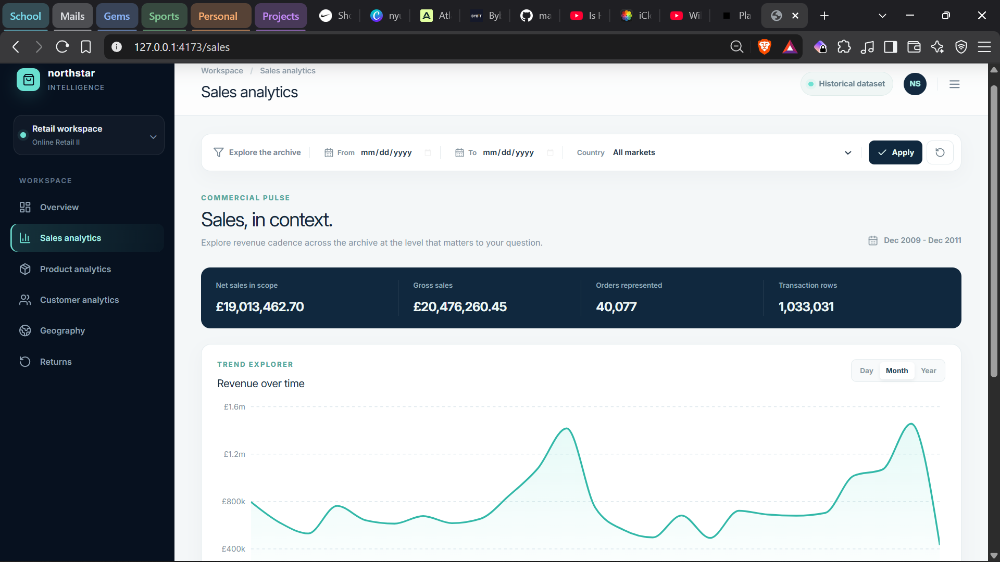
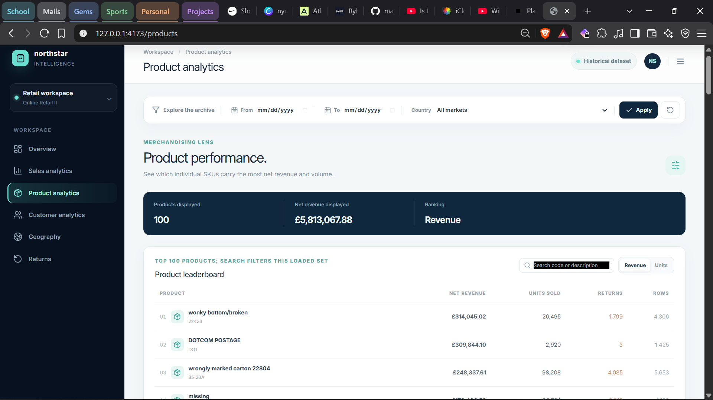
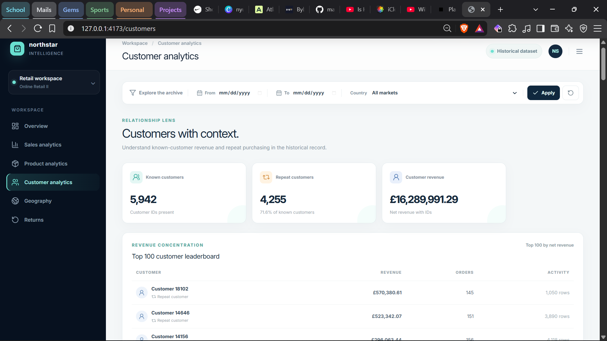
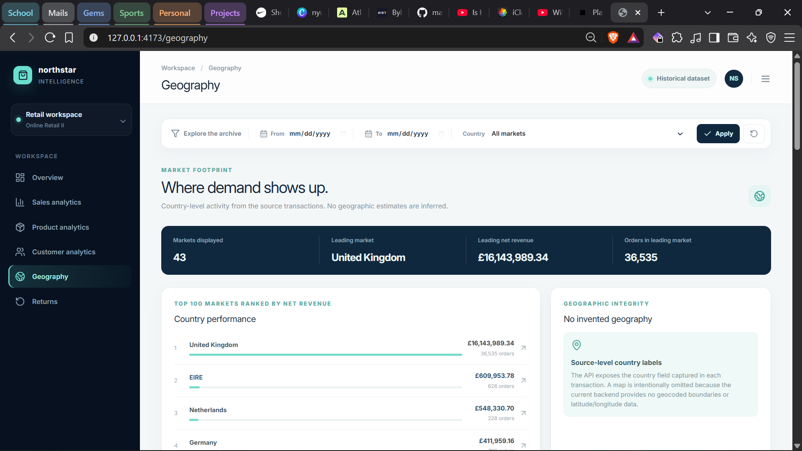
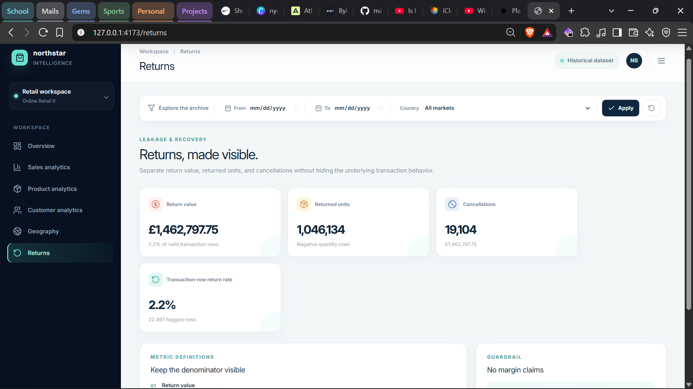

# Northstar Intelligence

**[Live Demo](https://northstar-intelligence.pages.dev/)** · [Backend API](https://northstar-intelligence.onrender.com/) · [GitHub repository](https://github.com/markbryson/northstar-intelligence)

Northstar Intelligence is a retail and e-commerce business intelligence platform for turning a large historical transaction archive into practical commercial insight. It helps users explore sales performance, product results, customer behavior, geographic markets, and returns through consistent filters and clearly defined KPIs.

The platform analyzes approximately **1.03 million retail transactions** from the historical UCI Online Retail II dataset. It is a historical analytics application, not a live-sales system.

## Features

The dashboard contains six focused analytical views:

- **Overview** — Executive KPI summary with net sales, gross sales, completed orders, customers, average order value, sales trends, returns context, top products, and leading countries.
- **Sales** — Revenue trends by day, month, or year, with gross sales, net sales, order counts, transaction-row counts, and historical date context.
- **Products** — Top product performance ranked by net revenue or units sold, with search across the loaded product results.
- **Customers** — Known-customer, repeat-customer, and customer-revenue metrics with a top-100 customer leaderboard.
- **Geography** — Country-level performance ranked by net revenue, with a top-100 market view based on source country labels.
- **Returns** — Return value, returned units, cancellations, and the transaction-row return rate, with denominator definitions kept visible.

All six pages share date and country filters and display loading, empty, and retryable error states.

## Technology stack

- **Backend:** Python, FastAPI, Uvicorn, Pandas, SQLite
- **Frontend:** React, TypeScript, Vite, Tailwind CSS, Recharts, Lucide React
- **Testing:** Pytest and HTTPX for backend endpoint and ingestion tests; TypeScript checks and a production frontend build

## Deployment architecture

```text
Cloudflare Pages (React/Vite frontend)
              │
              ▼
Render (FastAPI backend) ─── SQLite analytics database
              ▲
              │
GitHub Releases (deployment database asset)
```

- Cloudflare Pages hosts the production frontend.
- Render hosts the FastAPI backend.
- SQLite provides the read-only analytics data used by the API.
- GitHub Releases hosts the compact deployment database asset, keeping the large database out of the Git repository.

Render's free instance may take time to wake after inactivity, so the first request can be slower than subsequent requests.

## Key insights

The current dashboard is populated from the historical dataset and reports:

| KPI | Verified value |
| --- | ---: |
| Gross sales | **£20,476,260.45** |
| Returns | **£1,462,797.75** |
| Net sales | **£19,013,462.70** |
| Completed orders | **40,077** |
| Average order value | **£510.92** |
| Unique known customers | **5,942** |

These values describe the loaded historical records, not current trading activity.

## Dataset and attribution

Northstar Intelligence uses the official [UCI Online Retail II dataset](https://archive.ics.uci.edu/dataset/502/online+retail+ii), dataset 502, covering transactions from 2009 through 2011. The dataset is licensed under CC BY 4.0. The official archive should be downloaded as `online_retail_ii.zip`, extracted, and placed under `data/raw/` before ingestion. No synthetic data is used.

## Ingestion and data validation

The ingestion pipeline reads the workbook worksheet-by-worksheet in bounded batches. It supports profiling without import and reproducible loading into SQLite:

```powershell
python -m backend.ingestion --input data\raw\online_retail_ii\online_retail_II.xlsx --profile-only
python -m backend.ingestion --input data\raw\online_retail_ii\online_retail_II.xlsx --database data\database\retail.db
```

Data handling rules:

- Missing `Customer ID` values are retained as `NULL` rather than fabricated.
- Negative quantities are retained and classified as returns.
- Invoice numbers beginning with `C` are retained and classified as cancellations/returns.
- Exact duplicate source rows are detected with a SHA-256 content hash and ignored on insert through database uniqueness constraints.
- Rows with zero or non-numeric quantities, negative or non-numeric prices, missing required identifiers, or invalid dates are retained with `validation_status = 'invalid'` and validation errors.
- Invalid rows have zero financial amount fields, while their raw source values remain available for audit.
- Profit and margin are not calculated because the source dataset contains no product-cost field.

## KPI definitions

- A **transaction row** is one deduplicated source line stored in the `transactions` table.
- **Gross sales** are the sum of `quantity * unit_price` for valid, positive, non-cancelled transaction rows.
- **Returns** are the sum of `return_amount`, including cancellation rows.
- **Net sales** are calculated at line level as `gross sales - returns`.
- A **completed order** is a distinct non-cancelled invoice with positive gross sales after filters. Multi-line invoices count once.
- **Average order value** is net revenue from completed-order invoices divided by completed order count after invoice-level aggregation. It is not an average of line values.
- **Unique known customers** means distinct known customer IDs across valid transaction records. This can include customers who appear only on return or cancellation records; missing customer IDs are excluded.
- **Repeat customers** have at least two completed orders.
- **Transaction-row return rate** is returned or cancelled transaction rows divided by valid transaction rows in the selected scope. It is a row-based rate, not an order-, unit-, or sales-value return rate.
- Invalid rows are excluded from analytics calculations but remain stored for audit and reconciliation. Valid returns and cancellations remain included in return and net-sales metrics.

## Windows setup

Run these commands from the project folder in PowerShell. Activate the existing virtual environment first if required by your local setup.

### Backend

```powershell
python -m uvicorn backend.main:app --reload
```

The backend is available at [http://127.0.0.1:8000](http://127.0.0.1:8000). Interactive API documentation is available at `/docs`, and the database-aware health check is available at `/api/health`.

### Frontend production preview

The verified Windows workflow uses a production build followed by Vite preview:

```powershell
npm.cmd run build
npm.cmd run preview -- --host 127.0.0.1 --port 4173
```

The dashboard is available at [http://127.0.0.1:4173](http://127.0.0.1:4173). `npm.cmd run dev` is not the primary Windows startup method for this project because the current environment has a Vite development-server dependency-optimization/filesystem resolution issue. The production preview workflow is the verified local dashboard workflow.

## Render deployment

The deployment database is downloaded from the public GitHub Release asset during the Render build and is not committed to GitHub. Configure the Render service with:

**Build Command**

```text
pip install -r requirements.txt && python scripts/download_deployment_db.py
```

**Start Command**

```text
uvicorn backend.main:app --host 0.0.0.0 --port $PORT
```

Set `DATABASE_PATH=data/database/retail_deployment.db` and `DATABASE_READ_ONLY=true` in the Render environment. Set `CORS_ORIGINS` to the deployed frontend origin and build the frontend with `VITE_API_BASE_URL` pointing to the Render backend URL.

## Environment variables

Copy `.env.example` to `.env` only when local overrides are needed. The application reads:

| Variable | Purpose | Default |
| --- | --- | --- |
| `PROJECT_NAME` | FastAPI project name | `Business Intelligence Analytics Platform` |
| `APP_VERSION` | Application version | `0.1.0` |
| `DATABASE_PATH` | SQLite database path | `data/database/retail.db` |
| `DATABASE_READ_ONLY` | Open the configured SQLite database in read-only mode | `false` |
| `CORS_ORIGINS` | Comma-separated allowed frontend origins | Localhost ports used by development and preview |
| `VITE_API_BASE_URL` | Frontend API origin | `http://127.0.0.1:8000` |

Do not commit `.env` files or credentials. The frontend defaults to `http://127.0.0.1:8000` when `VITE_API_BASE_URL` is not provided; for the documented Windows workflow, set `VITE_API_BASE_URL=http://127.0.0.1:8000` if an explicit override is needed.

For a production deployment using the compact database, set `DATABASE_PATH=data/database/retail_deployment.db` and `DATABASE_READ_ONLY=true`. Read-only mode uses SQLite URI access and prevents the backend health check and analytics connections from creating or modifying the database.

## Analytics API

The analytics API accepts optional `start_date`, `end_date`, and `country` filters. Dates are inclusive and use `YYYY-MM-DD`. List endpoints accept `limit` values from 1 to 500 and non-negative `offset` values.

```text
GET /api/analytics/overview
GET /api/analytics/sales-trends?granularity=month
GET /api/analytics/top-products?limit=20&offset=0
GET /api/analytics/customers?limit=20&offset=0
GET /api/analytics/countries?limit=100&offset=0
GET /api/analytics/returns
GET /api/analytics/filters
```

Example requests:

```powershell
Invoke-RestMethod http://127.0.0.1:8000/api/health
Invoke-RestMethod http://127.0.0.1:8000/api/analytics/overview
Invoke-RestMethod 'http://127.0.0.1:8000/api/analytics/sales-trends?granularity=month&country=United%20Kingdom'
Invoke-RestMethod 'http://127.0.0.1:8000/api/analytics/top-products?limit=10'
```

Database connection, missing-file, locked-database, and SQLite failures return structured HTTP errors without exposing internal paths or tracebacks. The health endpoint checks that the analytics database exists and can be queried; it does not create an empty database during a health check.

## Testing and verification

Run backend tests:

```powershell
python -m pytest -q
```

Run the frontend type check and production build:

```powershell
npm.cmd run typecheck
npm.cmd run build
```

The repository includes ingestion tests, analytics endpoint tests, database-health/error-handling tests, TypeScript checking, and a production build workflow.

## Project structure

```text
backend/
  main.py       FastAPI application and system endpoints
  config.py     Environment-backed application settings
  database.py   SQLite schema and database utilities
  ingestion.py  Streaming profiler and ingestion command
  api/          FastAPI route modules, including analytics routes
  models/       Pydantic API response models
  services/     Analytics query services and business logic
tests/
  test_analytics.py
  test_ingestion.py
  test_main.py
src/
  api/          Typed FastAPI client
  components/   Dashboard UI, charts, tables, filters, and states
  context/      Global date/country filter state
  pages/        Overview, sales, products, customers, geography, and returns
  types/        API response and filter types
  utils/        Formatting helpers
data/
  raw/          Downloaded source workbook location
  database/     Local SQLite database location
vite.config.ts  Vite configuration and local API proxy
```

## Dashboard screenshots

### Overview Dashboard

Executive KPIs, sales trends, returns context, top products, and leading countries in one decision-ready view.



### Sales Analytics

Explore gross sales, net sales, completed orders, transaction rows, and revenue trends across selectable time granularities.



### Product Performance

Review the top loaded products by net revenue or units sold, with search across product codes and descriptions.



### Customer Analytics

Understand known customers, repeat customers, customer revenue, and the top customer leaderboard.



### Geographic Performance

Compare source-level country performance through the top markets ranked by net revenue.



### Returns Analysis

Monitor return value, returned units, cancellations, and the transaction-row return rate with its denominator clearly defined.



## Future improvements

Not yet implemented:

- Add an interactive product walkthrough or demonstration video.
- Add richer product/customer drill-down and export workflows.
- Add automated data-quality summary reporting for ingestion runs.
- Evaluate a production-oriented database and persistent hosting model for multi-user deployment.
- Add CI checks for backend tests, TypeScript, and the production build.
